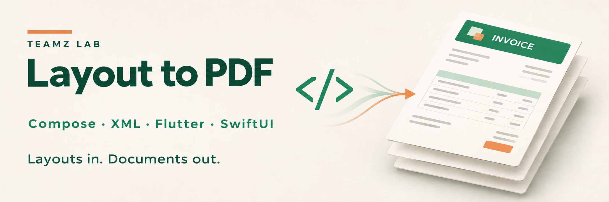
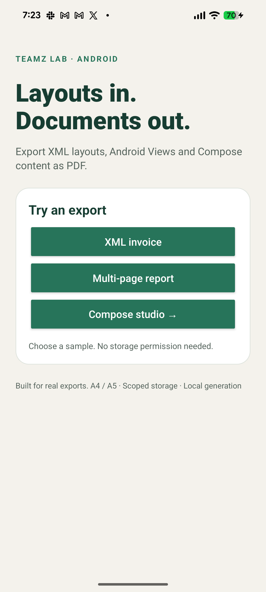
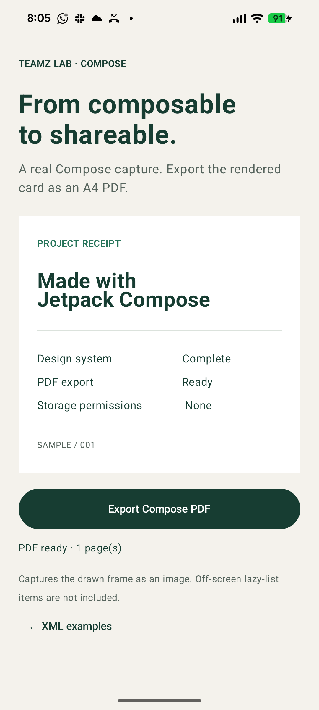
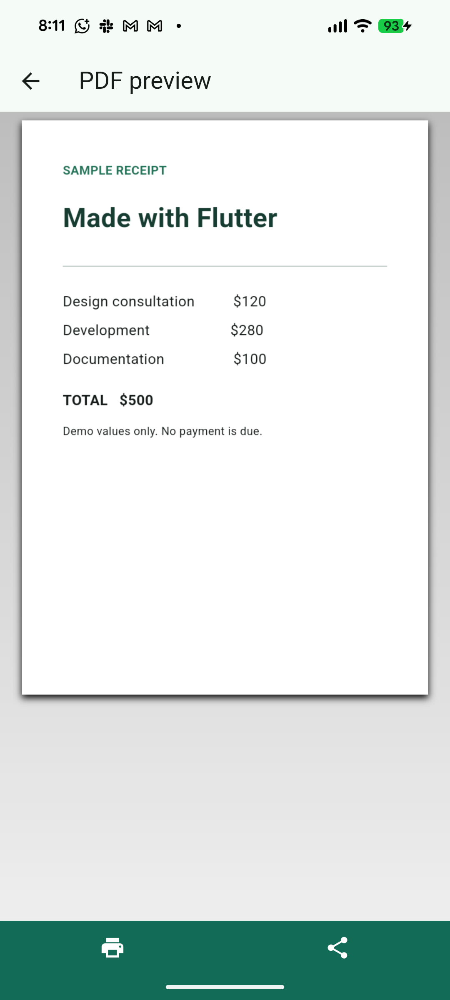
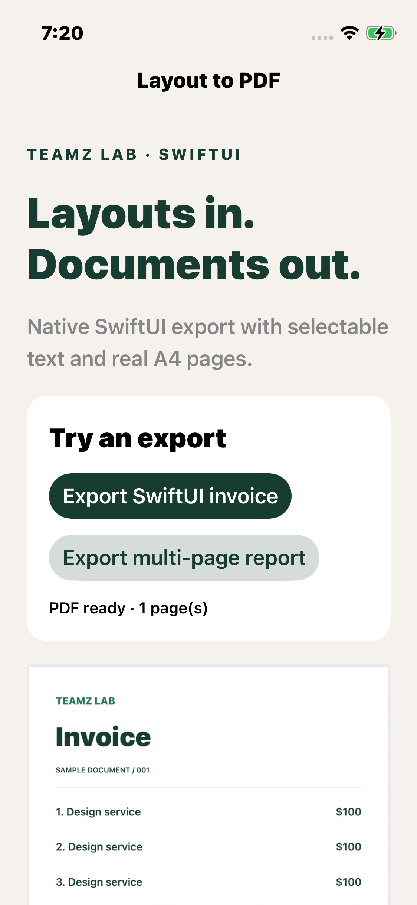

<p align="center">
  
</p>

# Layout to PDF · Compose, XML, Flutter & SwiftUI

**Turn app layouts into documents people can save, share and print.** Built by [Teamz Lab](https://teamzlab.com/?utm_source=github&utm_medium=opensource&utm_campaign=layout_to_pdf).

Generate PDFs from **Android XML layouts and Views**, capture **Jetpack Compose** content, export **Flutter widgets or text reports**, and render **SwiftUI** documents on Apple platforms. Local generation, explicit paper sizes, runnable examples and regression tests. No account, API key or mandatory watermark.

Previously **Android XML to PDF Generator**. The repository URL and Java package stay the same so existing links keep working.

[](https://github.com/Teamz-Lab-LTD/Android-XML-to-PDF-Generator/actions/workflows/ci.yml)
[](LICENSE)

[Quickstarts](#choose-your-platform) · [Examples](#see-the-output) · [Migration](docs/migration.md) · [Verification](docs/verification.md) · [Compare tools](docs/comparison.md) · [AI integration guide](docs/ai-integration.md)

> **Source-first preview:** the new adapters and Android 3.0 changes are available in this repository. They are not yet advertised as a published Maven Central or pub.dev release. The old `2.6.8` artifact does not contain these features. Use the source/module instructions below and pin a reviewed commit.

## Choose your platform

| Your app | Module | What goes into the PDF |
|---|---|---|
| Android XML / Java / Kotlin Views | [`xml-to-pdf`](xml-to-pdf) | Draws Views into Android's PDF Canvas; text/vector preservation depends on the View |
| Jetpack Compose on Android | [`compose-to-pdf`](compose-to-pdf) | Bitmap of the rendered capture area |
| Flutter | [`layout_to_pdf`](packages/layout_to_pdf) | Widget capture as pixels, or flowing text reports via `pdf` |
| SwiftUI on iOS / macOS | [`LayoutToPDF`](apple) | Native ImageRenderer/Core Graphics output; sample text remains selectable |

**Choose capture for visual fidelity to a rendered UI. Choose a document layout for flowing text and reports.** These are different rendering paths with different limits. See the [tested-platform matrix](docs/verification.md).

## What this project handles

- Android app-private saving without legacy storage permissions; optional system document picker for shared storage.
- A4/A5 paper sizes, landscape, margins and continuous page slicing for Android and SwiftUI.
- Content-URI results, cancellation handling and Android Activity recreation while saving.
- Flutter captures with image/page bounds, plus text reports with repeated headers, page numbers and optional bundled fonts.
- Independent adapters: XML users do not pull in Compose, and Apple/Flutter apps do not depend on Android binaries.
- Sample apps, output checks, CI and a migration guide for existing integrations.

## Android XML or View to PDF

The Android modules require **minSdk 21**. To build this repository, use **JDK 17** and **Android SDK 36**.

```bash
git clone https://github.com/Teamz-Lab-LTD/Android-XML-to-PDF-Generator.git
cd Android-XML-to-PDF-Generator
./gradlew :sample:assembleDebug :xml-to-pdf:publishReleasePublicationToMavenLocal \
  :compose-to-pdf:publishReleasePublicationToMavenLocal
```

For a local integration, add `mavenLocal()` to your dependency repositories:

```kotlin
implementation("com.github.Teamz-Lab-LTD:Android-XML-to-PDF-Generator:3.0.0")
// Optional Compose adapter:
implementation("com.github.Teamz-Lab-LTD.Android-XML-to-PDF-Generator:compose-to-pdf:3.0.0")
```

These coordinates refer to the **locally published** modules above. They are not a claim of availability from Maven Central. You can also include the source modules as the sample does.

```java
PdfGenerator.getBuilder()
    .setContext(this) // ComponentActivity, on the main thread
    .fromLayoutXMLSource()
    .fromLayoutXML(R.layout.document_invoice)
    .setPageSize(PdfGenerator.PageSize.A4)
    .setFileName("invoice")
    .setPageMargin(24) // PDF points, not dp
    .actionAfterPDFGeneration(PdfGenerator.ActionAfterPDFGeneration.NONE)
    .build(new PdfGeneratorListener() {
        @Override public void onSuccess(SuccessResponse result) {
            Uri pdf = result.getUri();
            // Read with ContentResolver; result.getPageCount() reports actual pages.
        }
        @Override public void onFailure(FailureResponse error) {
            // Show a useful error or cancellation state in your UI.
        }
    });
```

Use `.fromViewSource().fromView(view)` for dynamic content, or `.fromViewIDSource().fromViewID(activity, R.id.document)` for a View in your Activity. Multiple layouts/Views are accepted. Give detached layouts a fixed width; the [invoice example](sample/src/main/res/layout/document_invoice.xml) uses `595px`. View pixels describe the source; A4 PDF output uses `595 × 842` points.

### Save to Downloads or another document provider

```java
// In onCreate, once per Activity:
XmlToPDFLifecycleObserver saver = new XmlToPDFLifecycleObserver(this);
saver.setResultListener(listener); // Reattach on recreation.
getLifecycle().addObserver(saver);

// Add before build(listener):
// .savePDFSharedStorage(saver)
```

The user selects a destination. `result.getUri()` works for document providers; `result.getFile()` can be null. Cancel is reported through `onFailure` with `CancellationException`, then `onFinishPDFGeneration`. Do not request READ/WRITE_EXTERNAL_STORAGE for this flow. See [migration details](docs/migration.md).

## Jetpack Compose to PDF

```kotlin
val capture = rememberPdfCaptureState()
val scope = rememberCoroutineScope()

PdfCapture(capture) {
    InvoiceCard() // Your composable, with an explicit print-friendly theme.
}
Button(onClick = {
    scope.launch {
        try {
            capture.export(activity, "invoice", listener = listener)
        } catch (error: Exception) {
            // Capture must be attached and drawn; handle capture errors here.
        }
    }
}) { Text("Export PDF") }
```

Imports: `com.gkemon.pdf.compose.PdfCapture`, `rememberPdfCaptureState`. The [complete sample](sample/src/main/java/com/emon/exampleXMLtoPDF/ComposeDemoActivity.kt) handles coroutine cancellation and errors.

**Compose capture is raster.** It captures the drawn area, not off-screen `LazyColumn` items, WebViews or a whole navigation stack. Wait for data and images to render. For a long document, build explicit printable sections instead of capturing a virtualized list.

## Flutter PDF generation

Use the [Flutter package quickstart](packages/layout_to_pdf/README.md) for Git installation. Two APIs cover different needs:

```dart
// Capture a painted widget:
PdfCapture(captureKey: key, child: InvoiceCard());
final export = await captureToPdf(key, pageFormat: PdfPageFormat.a4);

// Or build a text report with flowing paragraphs:
final report = await buildReportPdf(
  title: 'Project report',
  sections: [ReportSection('Delivery', ['Design approved.', 'Export verified.'])],
);
```

Both return PDF bytes and page count. The [example app](packages/layout_to_pdf/example) uses `printing` for PDF preview, printing and sharing. The portable package targets Flutter's Android, iOS, web, macOS, Windows and Linux runtimes; actual test coverage is listed separately.

## SwiftUI to PDF

Add this repository through Xcode's **Add Package Dependencies** and select the `LayoutToPDF` product. Requires **iOS 16+ or macOS 13+**.

```swift
import LayoutToPDF

// Main actor, after your document data has loaded:
let export = try LayoutPDF.render(InvoiceView(), options: .a4)
try export.write(to: destinationURL)
```

See the [Apple quickstart](apple/README.md) and [iPhone sample](apple/Example). The native package provides PDF data and atomic writing; your app owns the save destination and sharing UI.

## See the output

Real device captures from the sample apps. The hero illustration is generated artwork; it is not a screenshot.

<p>
  
  
  
  
</p>

[Test commands and results](docs/verification.md)

## Limits to know before integrating

- Continuous page slicing can cut through a line or table row. Use explicit page Views or Flutter's document/report path when semantic page breaks matter.
- Pixel capture is not selectable text. Android and SwiftUI rendering may preserve text/vectors, but custom drawing, effects and bitmaps vary.
- Virtualized/off-screen content is not automatically rendered. Supply loaded, non-lazy document content.
- A light page background does not recolor white text from a dark UI. Use a dedicated print theme.
- Android pending saves survive Activity recreation, not process death. Restart an unfinished export after the process is killed.
- No PDF editing, signing, encryption, PDF/A or accessibility-tagged PDF guarantees. This is an export toolkit, not a complete PDF engine.
- No runtime network calls or analytics are added by these adapters. Your host app, remote images and preview/printing dependencies have their own behavior.

## Contribute or report a problem

Open a [reproducible issue](https://github.com/Teamz-Lab-LTD/Android-XML-to-PDF-Generator/issues/new/choose) with the export path, versions, a minimal layout and expected output. Remove personal/client data from attachments. See [CONTRIBUTING.md](CONTRIBUTING.md) and [maintenance policy](docs/maintenance.md).

## Built by Teamz Lab

We build Android, iOS and Flutter apps, including document export, reporting and workflow integrations. If your team needs a custom print layout, an existing app fixed, or a mobile product built, [talk to Teamz Lab](https://teamzlab.com/?utm_source=github&utm_medium=opensource&utm_campaign=layout_to_pdf&utm_content=readme_services#contact).

The library stays open source. Hiring us is optional, and your documents do not require a Teamz Lab watermark.

Apache-2.0 · Original Android library by **GK Emon** · [License](LICENSE)
